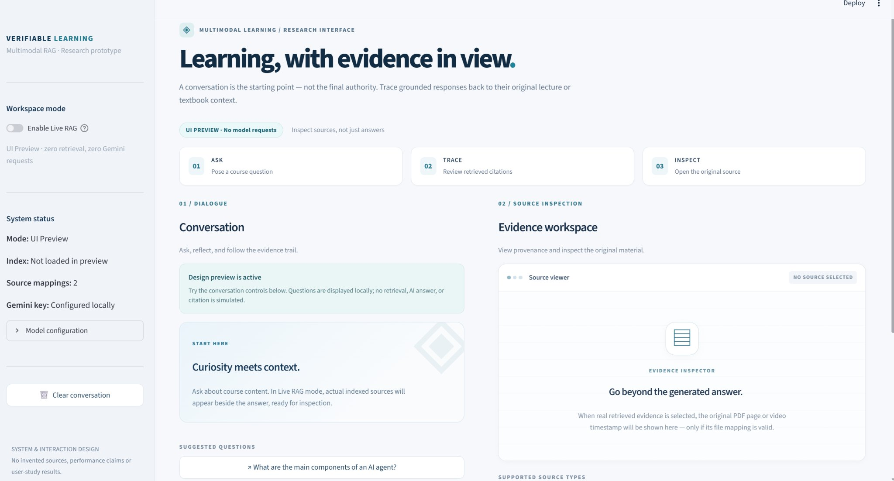

# Multimodal RAG Tutor — Verifiable Learning Workspace

**Designing Temporally Grounded Multimodal Learning Interfaces for Verifiable Interaction**

An evidence-first **Streamlit research prototype** that keeps the original Python + LlamaIndex + ChromaDB + Gemini retrieval pipeline and adds a split-pane learning workspace. A student can inspect actual retrieved textbook pages and lecture timestamps **when the matching original media are explicitly configured**.

**Core interaction:** User question → dense vector retrieval → Gemini answer + retrieved evidence → source chip → original PDF page / lecture video seek. **Retrieved sources are inspectable; the answer is not automatically fact-verified.**

**Research preprint (revised 16 October 2026):** [Zenodo DOI](https://doi.org/10.5281/zenodo.23418230) · [Read the eight-page PDF](paper/Wang_2026_Verifiable_Interaction_Revised_Preprint.pdf) · [LaTeX source](paper/latex/main.tex) · [Citation metadata](CITATION.cff) · [Paper and implementation notes](paper/README.md).

**Workshop history:** An earlier version was listed in [AIED 2026 Workshop — Spotlight Presentations II](https://extendedhorizon.com/aied2026ws-ai-hci-ls/program/). This revised preprint is an **independent, unreviewed revision**, not a separately accepted AIED conference paper or a Springer LNCS proceedings article. The independent revised preprint has been archived on Zenodo with version DOI **[10.5281/zenodo.23418230](https://doi.org/10.5281/zenodo.23418230)**. This is a repository-issued preprint DOI, **not** a peer-reviewed proceedings DOI.



*Actual local screenshot of UI Preview on Windows; it demonstrates layout, not a completed live RAG run or source navigation.*

## UI preview mode (default)

This version starts in **UI Preview** by default, so users can inspect the redesigned interface without loading BGE/Chroma or sending requests to Gemini. Questions typed in this mode appear locally only; **no answer or citation is fabricated**. Switch on **Enable Live RAG** in the sidebar to run the real retrieval pipeline. To force live mode at launch, set `RAG_UI_MODE=live`. See [UI_PREVIEW_使用说明.md](UI_PREVIEW_使用说明.md).

## Features

- Two-column, evidence-first UI (~40% conversation, 60% evidence viewer)
- Chroma/LlamaIndex dense retrieval over real indexed PDF text, image descriptions and video keyframe captions
- Gemini answer generation with evidence identifiers; retrieval-only behavior if a key is absent
- Real retrieved-source buttons, persistent in the current Streamlit session
- Explicit `sources.json` registry, validated PDF page numbers and video seconds, missing-source and error states
- PyMuPDF page render with page controls; Streamlit video seek with `start_time`
- No fabricated citations, guessed media locations or claimed BM25/ASR functionality

For precise status and limitations, see [docs/FEATURE_STATUS.md](docs/FEATURE_STATUS.md) and [docs/ARCHITECTURE.md](docs/ARCHITECTURE.md).

## Third-party teaching materials and public distribution

**Source disclosure:** The original textbook PDF and lecture MP4 used to prepare the local index came from teaching/course materials, not from the project author's own media. Ownership of a local copy does **not** grant permission to publicly re-upload it. This repository deliberately **does not ship** the original PDF, video, extracted figures/frames, video captions, textbook chunks, derived JSON exports or persisted Chroma vectors (which may also encode or reproduce third-party content).

The public `sources.example.json` contains **relative-path placeholders only**. A user with appropriate access may place matching, locally authorized materials in `assets/` and copy the example to the ignored `sources.json` file; a private absolute path may also be used locally. Never claim successful evidence navigation until the source edition and timestamps/page metadata have been checked. Without that private dataset and its index, the public checkout provides the **UI Preview and code**, not a turnkey end-to-end RAG demo.

See [Third-party materials and reproducibility](docs/THIRD_PARTY_MATERIALS.md) and [public release checklist](docs/PUBLIC_RELEASE_CHECKLIST.md). Any demo screenshot showing textbook pages or lecture frames must also be reviewed for redistribution rights.

## Requirements

- Python 3.10–3.12 recommended, with sufficient space/network for the BAAI/bge-small-en-v1.5 model on first load
- Google Gemini API key **only if** you want AI answers (fresh key; rotate the one exposed by the original project)
- Existing Chroma `rag_collection` data for retrieval (included only in the **Local** package)
- Matching original `Agents.pdf` and `Agents.mp4` for the evidence viewer (not included)

## Installation

From the unzipped project root:

**Windows PowerShell (Python 3.11):**

```powershell
py -3.11 -m venv .venv
.\.venv\Scripts\python.exe -m pip install -r requirements.txt
.\.venv\Scripts\python.exe -m streamlit run app.py
```

**macOS / Linux:**

```bash
python3 -m venv .venv
.venv/bin/python -m pip install -r requirements.txt
.venv/bin/python -m streamlit run app.py
```

The default **UI Preview** requires no Gemini API key or indexed course dataset.

Configure environment:

```bash
# Copy .env.example to .env and replace the placeholder with YOUR NEW secret key.
# Windows PowerShell: Copy-Item .env.example .env
# macOS/Linux: cp .env.example .env
```

Without a key you can still inspect **real retrieval results** (provided the index and embedding dependencies load) in retrieval-only mode. **Do not reuse the old exposed key.**

## Use the original index safely

**Local ZIP:** `chroma_db/` is already bundled. The app opens it non-destructively and checks that collection `rag_collection` contains records. It **does not** re-create or delete the index.

**GitHub-ready ZIP:** intentionally contains no `chroma_db/`, private media, original research data, or API keys. For your own local run, copy `chroma_db/` from your original ZIP or Local ZIP into this project folder. Do **not** upload it to GitHub without reviewing content and rights.

## Configure verifiable source navigation

1. Confirm which **actual** PDF/lecture video generated the indexed records.
2. Place those files at `assets/Agents.pdf` and `assets/Agents.mp4` **if they match**; otherwise change the paths below.
3. Copy `sources.example.json` to `sources.json`, inspect and confirm the mappings. This step is a deliberate declaration by the dataset owner that files and page numbering/timestamps correspond to the existing index.
4. Launch the app; a button with valid position metadata becomes navigable. Missing files or mismatched/invalid metadata produce explicit warnings.

The supplied legacy Chroma index uses generic metadata `source="PDF Document" / "Video Tutorial"` instead of stable IDs. The example aliases only work when those generic sources genuinely refer to **one particular PDF and one particular video**. For multiple assets, reindex with `source_id`/`video_id` metadata. **Never copy arbitrary files under these names just to make a video/PDF button appear functional.**

## Run

```bash
python -m streamlit run app.py
```

Open the URL shown by Streamlit (typically `http://localhost:8501`). **The default UI Preview does not load model weights.** To run real retrieval, turn on **Enable Live RAG** in the sidebar; at that point the BGE model may require a first-time download. Ask a real question, then click a retrieved evidence button. PDF/video navigation requires matching media and a configured registry.

For the optional text-only variant:

```bash
python -m streamlit run app_baseline.py
```

## Optional: rebuild into a *new* index (not required for the supplied DB)

The original pipeline exports JSON with PDF text, figure descriptions, and video frame descriptions. Source input media must be legally usable. Optional preprocessing dependencies:

```bash
python -m pip install -r requirements-ingestion.txt
python process_pdf_text.py --pdf assets/Agents.pdf --output pdf_text.json
python process_pdf_images.py --pdf assets/Agents.pdf --output-dir Extracted_images --output Image_description.json
python Process_video.py --video assets/Agents.mp4 --frames video_frames --output video_data.json
python build_index.py --pdf-json pdf_text.json --images-json Image_description.json --video-json video_data.json --pdf-source-id agents_textbook --video-source-id agents_lecture --db-path chroma_db_new
```

Do **not** move/repoint `chroma_db_new` over the original unless you have separately verified the new index and backed up the old one. `build_index.py` refuses a nonempty destination and missing JSON inputs. Offline inference can incur API charges and takes time.

## Tests

```bash
python -m pip install -r requirements-test.txt
python -m pytest -q
```

Tests cover pure metadata validation, explicit source mapping, a non-destructive index-build guard and the no-backend UI Preview initialization guard. **A local UI Preview screenshot has also been observed.** The user separately observed retrieved evidence chips, but full media seeking, PDF navigation and reliable Gemini inference have **not** been confirmed. These tests are not an end-to-end benchmark.

## Research honesty and known limits

- No verified hybrid BM25 retrieval, speech ASR, fine-grained passage bounding-box highlights, or account-level conversation persistence.
- Indexed video records are keyframe/scene descriptions, **not** a full synchronized speech transcript.
- Current citations are **retrieved context chips**, not verified per-sentence claim attribution in the model answer.
- No benchmark, user-study effect or performance metric is claimed. Old charts/CSV data were excluded pending independent validation.
- PDF pages are rendered at the stored 1-based page number; a book's printed folio may differ. A wrong source edition must be corrected in `sources.json`, not silently inferred.
- Without original course PDF/video or a valid personal key, full end-to-end interaction cannot be confirmed.

## Demo and further details

- [Architecture & provenance](docs/ARCHITECTURE.md)
- [Honest feature status](docs/FEATURE_STATUS.md)
- [Security and GitHub checklist](docs/SECURITY.md)
- [Two-minute demo script](docs/DEMO_SCRIPT.md)
- [GitHub publishing steps (中文)](docs/GITHUB_PUBLISH_中文.md)
- [Portfolio description and honest technical highlights](docs/PORTFOLIO_BLURBS.md)

## Reference

**Wang, R. (2026).** *Designing Temporally Grounded Multimodal Learning Interfaces for Verifiable Interaction.* Revised system and interaction-design preprint, 16 October 2026. Zenodo. [DOI](https://doi.org/10.5281/zenodo.23418230) · [PDF](paper/Wang_2026_Verifiable_Interaction_Revised_Preprint.pdf) · [BibTeX](paper/preprint.bib).

The preliminary version appeared in the AIED 2026 Workshop Spotlight II program. The revised PDF is not represented here as a peer-reviewed proceedings publication. See [citation metadata](CITATION.cff). Version DOI: [10.5281/zenodo.23418230](https://doi.org/10.5281/zenodo.23418230). A DOI for the Zenodo preprint is not evidence of an additional peer-reviewed conference or journal publication. No arXiv identifier is claimed.

## License

**No open-source license selected yet.** Add an explicit license only once you have chosen its terms and verified redistribution rights for all included content.
